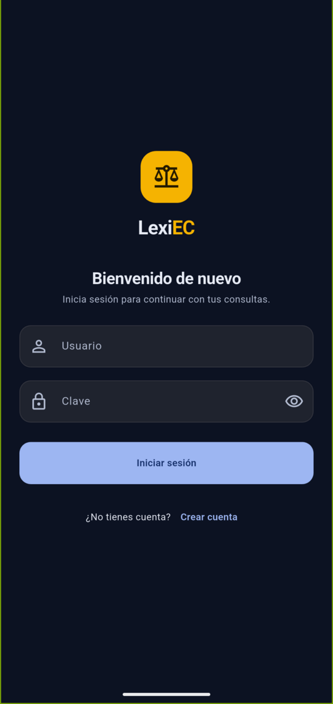
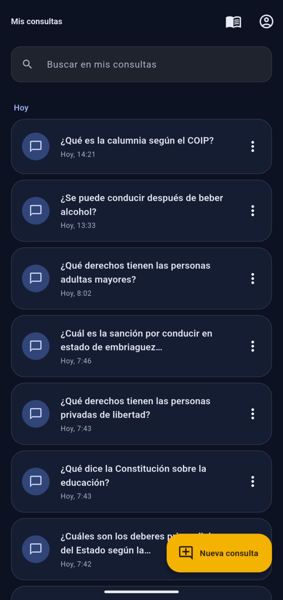
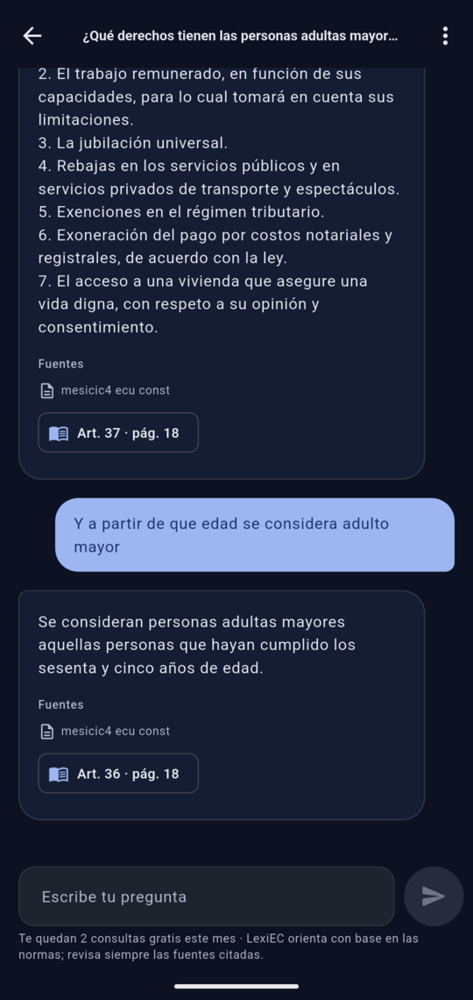
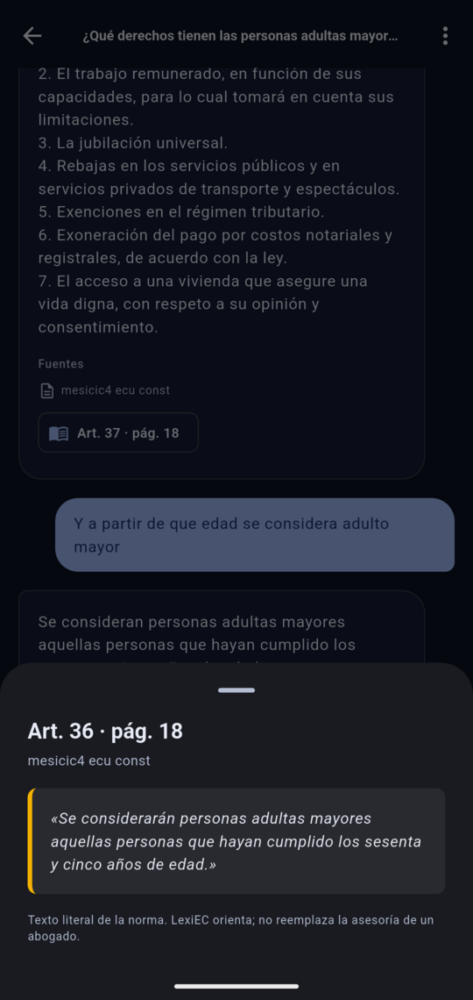
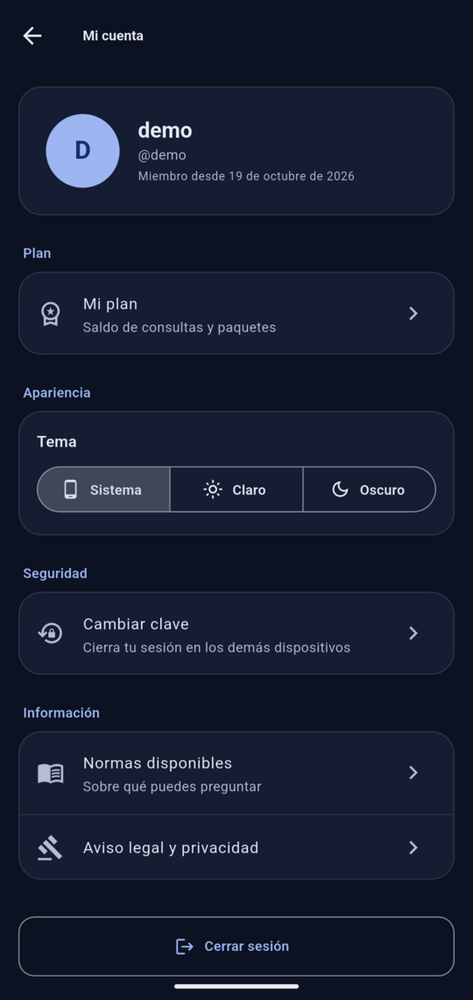
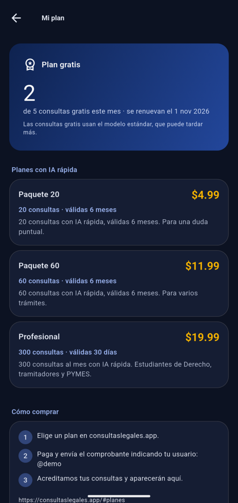

# LexiEC

App Android para consultar la legislación ecuatoriana conversando con un asistente de IA. Responde
solo con lo que dicen las normas cargadas en el servidor y cita el artículo y la página de cada
fuente. Está pensada para estudiantes y ciudadanos que necesitan orientarse en una norma sin leerla
completa. Es orientación y no reemplaza la asesoría de un abogado.

## Capturas de pantalla

| Inicio de sesión | Mis consultas | Asistente de IA con fuentes |
|:---:|:---:|:---:|
|  |  |  |
| **Texto literal de la cita** | **Mi cuenta** | **Mi plan** |
|  |  |  |

Las capturas se tomaron en un Pixel 9a físico, con la cuenta de demostración y el backend local
(build de depuración, que se instala como "LexiEC (dev)" junto al APK del Release).

## Qué incluye

- [x] Registro (con código de invitación), inicio y cierre de sesión con **JWT del backend propio**
  (access token y refresh token que rota). La sesión sobrevive al reinicio.
- [x] Lista principal **Mis consultas** desde la API, paginada, con estados de carga (esqueleto),
  vacío, error con **Reintentar** y aviso de modo sin conexión.
- [x] Persistencia local que sobrevive al reinicio: **historial de consultas** en Hive cifrado con
  AES-256 (se puede leer sin conexión), más las preferencias de tema y de bienvenida.
- [x] Datos remotos protegidos por autorización: crear, ver y eliminar **consultas (conversaciones)**.
  Sin token, o con el token de otro usuario, la API responde 401 o 404.
- [x] Asistente con IA mediante el servidor propio [`lexiec_ia`](https://github.com/Katarisoft/lexie_ia),
  que usa RAG sobre PDFs con un LLM local. Las respuestas llegan en streaming (SSE). La app solo conoce
  la URL del servidor y no guarda ninguna clave.
- [x] Estado compartido con GetX: `SesionController` y `ConversacionesController` se comparten entre
  pantallas y las dependencias se registran en `Bindings`.
- [x] Extras:
  - Mi cuenta: perfil, cambio de clave, eliminación de la cuenta y tema claro, oscuro o del sistema.
  - Mi plan: saldo de consultas (gratis con el modelo local, paquetes pagados con IA rápida), planes a
    la venta y cómo comprarlos en consultaslegales.app. Sin saldo, el chat lo explica y ofrece "Ver planes".
  - Lista de normas disponibles.
  - Esperas con cuenta regresiva ante 429 y 503.
  - Contraste AA verificado con pruebas y soporte de letra grande.

## Cómo ejecutarla

Requisitos:

- Flutter **3.44.0** (Dart 3.12) y Android SDK 24 o superior.
- Para el backend local: Linux con Python 3.12, Docker (PostgreSQL y Qdrant) y Ollama.

1. **Backend** (repositorio `lexiec_ia`, rama `main`):

   ```bash
   git clone https://github.com/Katarisoft/lexie_ia.git lexiec_ia
   cd lexiec_ia
   ./scripts/setup.sh --dev                         # venv, dependencias, .env, PostgreSQL + Qdrant, modelos de Ollama
   cp /ruta/a/tus/normas/*.pdf documentos/
   .venv/bin/python -m app.ingest                   # indexa los PDF
   ./scripts/run_dev.sh                             # API en http://127.0.0.1:8010 (documentación en /docs)
   ```

   Para crear una cuenta hace falta un código de invitación, que se configura en el `.env` del
   backend. El script `scripts/sembrar_demo.py` crea una cuenta de demostración con consultas reales
   hechas a través de la API.

2. **App:**

   ```bash
   flutter pub get
   cp .env.example .env                             # solo contiene la URL del backend (no es secreta)
   flutter run --dart-define-from-file=.env
   ```

3. **Direcciones por entorno.** Se definen al compilar con `API_BASE_URL`:

   | Entorno | Valor |
   |---|---|
   | Sin definir (APK del Release) | `https://lexiec.katarisoft.com/api/v1` (producción) |
   | Emulador Android | `http://10.0.2.2:8010/api/v1` (el que trae `.env.example`) |
   | Dispositivo físico por USB | `adb reverse tcp:8010 tcp:8010` y luego `flutter run --dart-define=API_BASE_URL=http://127.0.0.1:8010/api/v1` |

   El tráfico HTTP sin TLS solo se permite en las builds de depuración y solo hacia `10.0.2.2`,
   `localhost` y `127.0.0.1`. La build de release exige HTTPS.

**Cuenta de demostración:** el usuario y la clave se entregan por Moodle. No se publican en este
repositorio.

## APK

Descárgalo desde la sección **Releases** de este repositorio (archivo `lexiec-vX.Y.Z.apk`). Lo genera
GitHub Actions al subir una etiqueta `v*` (ver `.github/workflows/release-apk.yml`). El workflow
ejecuta `flutter analyze` y `flutter test` antes de compilar y apunta a
`https://lexiec.katarisoft.com/api/v1`.

Para instalarlo:

1. Copia el APK a un emulador o teléfono Android 7.0 o superior y ábrelo. Antes, permite instalar apps
   de origen desconocido.
2. Inicia sesión con la cuenta de demostración.

Si no hay keystore en los *secrets* del repositorio, el APK se firma con la clave de depuración. Se
instala normalmente, pero no sirve para Play Store.

## Arquitectura

```text
lib/
├── app/          rutas (GetPage + middlewares), bindings y tema (único lugar con colores y espaciado)
├── core/         configuración de entorno, cliente dio con interceptores, lector SSE, errores tipados
├── data/
│   ├── models/        conversación, mensaje, cita, documento, perfil… (fromJson/toJson)
│   ├── datasources/   remote_* (API) y local_* (Hive cifrado, secure storage)
│   └── repositories/  combinan servidor y caché local
├── controllers/  estado con GetX (ViewStatus: loading / empty / error / success)
├── screens/      una carpeta por pantalla (solo interfaz, sin HTTP, Hive ni secure storage)
└── widgets/      LoadingView, EmptyView, ErrorView, burbujas del chat, tarjetas…
```

Así viaja un dato. `ConsultasScreen` observa con `Obx` a `ConversacionesController`. El controlador
pide la primera página a `ConversacionesRepository`. El repositorio la obtiene de
`RemoteConversacionesDatasource`, que usa dio. En el camino, `AuthInterceptor` agrega el token y
renueva la sesión si recibe un 401, y `RequestIdInterceptor` agrega `X-Request-ID`. Con la respuesta,
el repositorio guarda una copia en Hive cifrado y devuelve modelos tipados. Si no hay red, entrega el
historial local y lo marca como "sin conexión".

Los errores HTTP se convierten en excepciones tipadas en la capa de datos, y el controlador los
traduce a texto: 400, 401, 403, 404, 422, 429, 5xx y sin conexión tienen mensajes distintos.

Más detalle, con el flujo del chat en streaming y de la sesión, en [docs/ARQUITECTURA.md](docs/ARQUITECTURA.md).

## Decisión técnica propia

**Una sola renovación del token aunque fallen varias peticiones a la vez.** El backend rota el refresh
token en cada uso: el anterior queda revocado y reutilizarlo cierra la sesión. Con un interceptor
normal, dos peticiones que reciben 401 al mismo tiempo renovarían dos veces y la segunda expulsaría al
usuario.

- **Elegido:** `AuthInterceptor` extiende `QueuedInterceptor` de dio, que procesa los errores de uno en
  uno. La primera petición renueva el token. Las demás ven que el token guardado ya cambió y solo
  reintentan con él.
- **Descartado:**
  - Un candado manual con `Completer`: hace lo mismo con más código propio que mantener.
  - Renovar por adelantado leyendo la expiración del JWT: depende del reloj del teléfono y no evita el
    caso de carrera.

Hay pruebas de este caso en `test/core/auth_interceptor_test.dart`.

Otras decisiones, explicadas en `docs/ARQUITECTURA.md`:

- El historial local va cifrado porque las consultas pueden contener datos personales.
- En el chat, el texto provisional que llega por streaming se reemplaza por la respuesta verificada,
  con sus citas.

## Tecnologías

| Paquete | Uso |
|---|---|
| `get` | Estado reactivo, inyección de dependencias (Bindings), rutas y middlewares |
| `dio` | Cliente HTTP con interceptores (token, renovación, X-Request-ID) y streaming SSE |
| `flutter_secure_storage` | Tokens de sesión y clave AES de la caché (Android Keystore) |
| `hive`, `hive_flutter` | Historial local cifrado y preferencias |
| `intl`, `flutter_localizations` | Fechas y textos de Material en español |
| `mocktail`, `flutter_test` (dev) | Pruebas unitarias y de widgets |
| `flutter_lints` (dev) | Reglas de análisis estático |

En el backend se usan FastAPI, PostgreSQL, Qdrant (búsqueda híbrida), Ollama (`llama3.2:3b` y
`embeddinggemma`) y streaming SSE.

## Seguridad

- No hay claves ni secretos en el repositorio. `.env` está en `.gitignore` y `.env.example` solo
  contiene la URL del backend.
- Los tokens se guardan con `flutter_secure_storage` y nunca se imprimen. Al cerrar sesión se revoca
  el refresh token en el servidor y se borran los tokens y el historial local.
- El historial local va cifrado con AES-256. La clave se genera en el dispositivo y vive en el
  almacenamiento seguro.
- La app no conoce ninguna clave de IA, porque el modelo corre en el servidor propio.
- La build de release solo permite HTTPS.
- La firma del APK usa los *secrets* de GitHub. El keystore y `key.properties` no se versionan.

## Créditos y licencias

- Ícono de la app: glifo *balance* de [Material Icons](https://fonts.google.com/icons) (Google),
  licencia Apache 2.0.
- Normas consultadas: legislación ecuatoriana publicada en el Registro Oficial. Son textos públicos y
  su uso aquí es solo informativo.
- Paquetes de Flutter, cada uno con su licencia en pub.dev:
  - `get`, `dio`, `mocktail`: MIT.
  - `hive`, `hive_flutter`: Apache 2.0.
  - `flutter_secure_storage`, `intl`, `flutter_lints`: BSD-3.
- Backend: FastAPI (MIT), Qdrant (Apache 2.0), Ollama (MIT), Llama 3.2 (Llama 3.2 Community
  License), EmbeddingGemma (Gemma Terms of Use).
- Proyecto Final del curso *Desarrolla Aplicaciones Móviles Robustas con Flutter e IA*.
